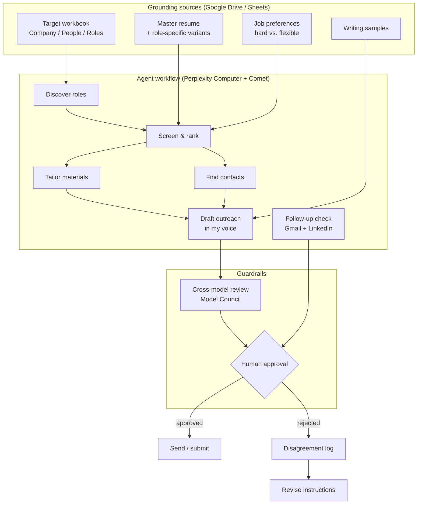

# AI Job Search & Outreach Assistant

A personal AI agent workflow I designed to run my own job search: it screens postings against my background and preferences, picks the few roles actually worth applying to, and drafts tailored resumes, referral requests, and outreach in my voice. Nothing is sent or submitted without my review.

> **What this repo is:** the design of a configured workflow (instructions, reusable skills, data structure, guardrails, and lessons learned), not a standalone coded application. It runs on Perplexity Computer and the Comet browser, grounded in documents I maintain in Google Drive and Sheets.

**Status:** In active use since 10/2026 · **Author:** [Kevin Terrier](https://www.linkedin.com/in/kevin-terrier)

---

## The problem

Job boards and generic AI job tools optimize for volume: apply to as many roles as possible. That didn't work for me. My search has specific constraints (target role families, location and pay preferences, and a work-authorization requirement that rules out many postings), and most of my best results come from warm referrals rather than cold applications.

I needed something that would:

- Read hundreds of postings and tell me which **3** were worth my time, with reasons.
- Never invent experience or overstate a skill.
- Write messages that sound like me, not like a template.
- Keep me in control of every message and application.

## What it does

| Stage | Input | Output |
|---|---|---|
| **1. Discovery** | Company list, careers sites, LinkedIn jobs | Inventory of open roles |
| **2. Screening** | Master resume, preferences doc | Roles scored on required vs. preferred criteria; hard filters applied; one best-fit role per company |
| **3. Tailoring** | Best-fit role + master resume | Role-specific resume emphasis, cover letter if needed, referral blurb |
| **4. Networking** | LinkedIn connections, message history | 3–5 ranked contacts per company and personalized connection notes / messages |
| **5. Follow-up** | Gmail + LinkedIn inbox | Replies, referral links and recruiter asks triaged and drafted |
| **6. Human review** | Everything above | I edit, approve, and send. The agent never does. |

**Example result:** in one company audit, the workflow narrowed **~500 open postings to 3** worth applying to. (This is a single example, not a measured average.)

## Architecture



More detail in [`architecture/design-decisions.md`](architecture/design-decisions.md).

### Three layers of data

I separate what the agent reads into three layers so instructions stay stable while the inputs change:

1. **Instructions:** how to behave (rules, voice, guardrails).
2. **Reference data:** who I am and what I want (master resume, preferences, writing samples). Read fresh every run, never from memory.
3. **Operational data:** what I'm working on now (target companies, people, roles).

## Guardrails

These are the parts I spent the most time on, because a job search agent that's confidently wrong is worse than no agent.

- **Grounded in source documents.** The agent reads the current resume and preferences from Drive at the start of every run and reports which version it used (a "source check").
- **No invented facts.** It can tailor emphasis, but every claim has to trace back to the master resume. Skills I only have familiarity with are labeled that way.
- **Required vs. preferred.** Postings are scored honestly against what they actually require. If nothing fits, the agent says so instead of forcing a weak match.
- **Cross-model review.** Drafts and instructions are checked with Perplexity Model Council (several models compared). I originally did this by hand, copying output between ChatGPT and Claude until neither proposed changes. Agreement between models isn't treated as proof. I make the final call.
- **Disagreement log.** When I reject or rewrite an output, I note why, and use those notes to revise the instructions.
- **Human approval before anything leaves.** Messages are staged in the browser and applications stop on the review page. Sending requires my explicit approval and a final "Are you sure?" confirmation.
- **Platform limits respected.** LinkedIn connection notes are counted to 300 characters, and no paid InMail is used without asking.

## Repo contents

```
README.md                          ← you are here
architecture/design-decisions.md   ← why it's built this way
examples/sample-run.md             ← an end-to-end run with a fictional company
lessons-learned.md                 ← what worked, what didn't, what changed
```

**Full version available on request.** The complete project instructions, the three reusable skills (company job hunt & outreach, friend intro finder, networking follow-up check), and the data templates are kept in a private repository. I'm happy to walk through them in an interview or share access with a hiring team. Reach me on [LinkedIn](https://www.linkedin.com/in/kevin-terrier).

## Tools

**Perplexity Computer** (agent orchestration, skills, scheduled runs) · **Comet** (logged-in browser actions on LinkedIn and application sites) · **Perplexity Model Council** (cross-model review) · **Google Drive, Docs, Sheets** (grounding sources) · **Gmail** (follow-up triage)

## Beyond my own search

I reused the same design (writing samples for voice, review before sending, documented limitations and escalation rules) to set up reply assistants for two friends who were overwhelmed by texts and emails.

## What I'd do next

- Add measurement: track time per application and response rates so the impact isn't anecdotal.
- Rebuild the screening step as a small coded agent in Python so the scoring logic is testable and version-controlled.
- Add a duplicate-contact check across channels as a hard rule instead of an instruction.

---

*Personal names, contact details, document links, and private search details have been removed or replaced with placeholders.*

© 2026 Kevin Terrier. All rights reserved. This repository is shared for portfolio review only; see [LICENSE](LICENSE).
